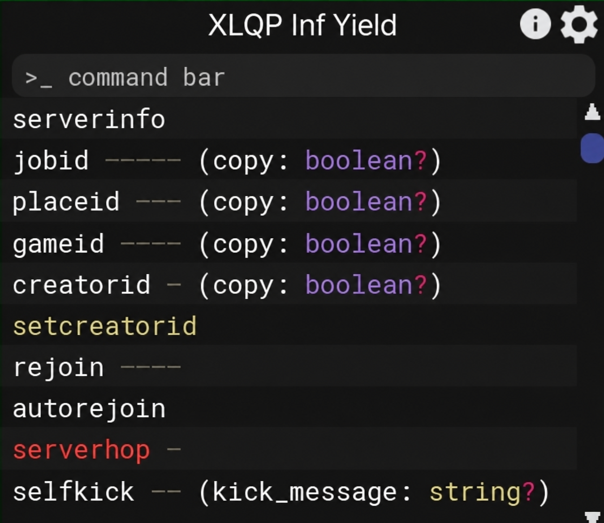

# XLQP

XLQP is a modular Roblox command interface. Source modules, optional tools, dependency snapshots, fonts, and image files are kept in separate folders.

## Loadstring

```lua
loadstring(game:HttpGet("https://raw.githubusercontent.com/josediaz765/xlqp/main/loader.luau"))()
```

The hosted loader fetches one startup package containing the application modules and interface assets. Its source bytes are cached for repeat executions in the same game session; each execution still initializes the application normally. Optional tools remain separate and download only when used. Optional dependency URLs resolve to the copies under `vendor/`.

The source remains modular. After editing application modules or assets, run `python tools/build_startup.py` and publish the generated `runtime/startup-<revision>.luau` with the updated loader. `python tools/build_startup.py --check` detects a stale package. This fresh repository contains the current generated package.

[Discord](https://discord.gg/dFpeqN4UHk)

## Local copy

Clone or extract the repository into your executor workspace as `xlqp`, then run:

```lua
getgenv().XLQP_LOCAL = true
loadstring(readfile("xlqp/loader.luau"))()
```

To use another folder, set `getgenv().XLQP_ROOT` to its name. To return to the hosted loader, set `getgenv().XLQP_LOCAL = false`.

## Files

| Path | Contents |
| --- | --- |
| `loader.luau` | Hosted/local entry point and module file cache |
| `main.luau` | Application startup and teleport reload setup |
| `rbxBundle.luau` | XLQP module resolver |
| `runtime/` | Generated startup packages with versioned paths |
| `tools/build_startup.py` | Rebuilds the package and updates the loader revision |
| `src/core/` | Startup and cleanup |
| `src/commands/` | Commands, controllers, services, and systems |
| `src/ui/` | Interface components and themes |
| `src/framework/resources.luau` | Optional scripts and resource loading |
| `src/framework/resourcesIndex.luau` | File paths and dependency aliases |
| `backups/` | Optional upstream tools and historical sources |
| `vendor/` | Dependency scripts, fonts, images, and metadata snapshots |
| `LICENSES/` | Upstream and dependency notices |

## Command input

Press `;` (the default prefix) to reveal and focus the command bar. Prefix focus no longer waits for the window animation, and the prefix still works if Roblox marks the key as processed while no textbox is focused. Other textboxes keep their focus. The binding remains configurable. On mobile, tap the XLQP button or the command field to use the native keyboard. Drag the window using its title bar.

Typing filters the visible command rows immediately by command name or alias, ignoring case. For example, `dex` shows matching explorer commands and hides unrelated commands. Clearing the text restores every row and section. Filtered scroll bounds follow the matching rows. This follows the prefix-focus and matching-list behavior in the [original Infinite Yield source](https://raw.githubusercontent.com/EdgeIY/infiniteyield/master/source).

The command textbox uses native editing and caret/selection while focused. Syntax highlighting returns when it loses focus. Enter or the send button submits a command; Tab accepts a correction. XLQP text uses red, purple, and green across its themes and syntax colors.

Run `python tools/test_input.py --runtime luau` for keyboard/mobile signal-fixture regression checks, and add `--case filter` to check live command filtering. These fixtures exercise the application modules with Roblox UI/input mocks; they do not drive a physical device.

## Runtime and verification

Optional downloads run through a normal resource lookup function, allowing HTTP to yield without crossing a metamethod boundary. Run `python tools/test_resources.py --runtime luau` to check yielding Cobalt loads, caching, aliases, retries, and concurrent callers.

The emote menu applies its configuration before binding keys: a missing or invalid key uses Period (`.`), and a failed launch does not mark it as running. Desktop launches also clear a stale running flag when the menu key binding is absent. Optional tool commands report success after their initializer returns, capture download/compile/initialization failures in the command error log, reject overlapping launches of the same tool, and allow retry after failure. Emote dependencies propagate failures instead of returning empty placeholder functions. Wallwalk validates its controller before caching it.

Run `python tools/test_optional.py --runtime luau` to exercise the actual emote configuration/keybinding, dependency loader, all seven tool launch variants, and Wallwalk with fault injection. These tests use Roblox service mocks. They cover synchronous initialization and yielding downloads; third-party background callbacks and live game behavior require in-game testing.

Dex API-dump URLs beginning with `version-` resolve to JSON snapshots; only the exact setup `/version` endpoint resolves to version text. API-dump query strings and full dumps are covered by the resource regression checks. The full loader check also validates the real API snapshot and its routing.

Run `python tools/test_startup.py --runtime luau --expect-fast` to check startup requests, repeat execution, lazy optional tools, teleport continuations, cache isolation, and recovery after failed downloads. The startup corpus fixture requests all 303 application modules and 23 interface assets through the actual loader and resolver while replacing Roblox module execution with stubs. It uses 1 cold request and 0 repeat requests, compared with 328 each before the change; the outer loadstring request is excluded. These counts are fixture measurements, not in-game timing measurements.

Roblox and the executor APIs used by the project are required. The local mode uses repository files without source downloads. Roblox models, animations, thumbnails, gameplay services, and optional external decompiler services retain their live-service behavior. Catalog and engine metadata snapshots remain fixed until updated.

All 369 source files compile. Hosted/local loader fixtures cover 430 resource mappings, 361 lazy source files, 15 literal nested script URLs outside the historical legacy source, and teleport continuations. UI startup is intercepted in those fixtures; in-game behavior has not been tested. See `VERIFICATION.txt`. With the Luau command-line compiler and runtime installed, run `python tools/verify.py --compiler luau-compile --runtime luau` to repeat the checks.

The upstream `f3x` command has no configured script source; that existing behavior is preserved.

## Screenshots

The two screenshots containing the old RV title now display **XLQP Inf Yield**. They were edited with the built-in image generator; their layout and visible command text were visually checked. The reference and server screenshots are unchanged. Generated PNGs replace the old JPEGs, with the old resource keys retained for compatibility.



[Interface comparison](images/interfaceComparasion.png)

## Upstream

Derived from [tlredz/iy-remake](https://github.com/tlredz/iy-remake), commit `b07d157654be3bd65f2235ab1ed1f545f5361f95`. Original project: [EdgeIY/infiniteyield](https://github.com/EdgeIY/infiniteyield). Original notices are retained under `LICENSES/`; source URLs and download hashes are recorded in `UPSTREAM.json`.
